# Visual Gallery

Every image below is rendered directly by `xeet` from [`app/_lib/hard.js`](../app/_lib/hard.js) via [`tools/ship/readme-gallery.mjs`](../tools/ship/readme-gallery.mjs) in both `light` and `dark` themes — GitHub automatically shows the theme matching your appearance setting. Try or customize any post interactively at **[xeet-rs.vercel.app](https://xeet-rs.vercel.app)**.

<table>
<tr>
<td width="50%" valign="top">
<picture><source media="(prefers-color-scheme: dark)" srcset="gallery/duo-mihar-web-dark.webp"><source media="(prefers-color-scheme: light)" srcset="gallery/duo-mihar-web-light.webp">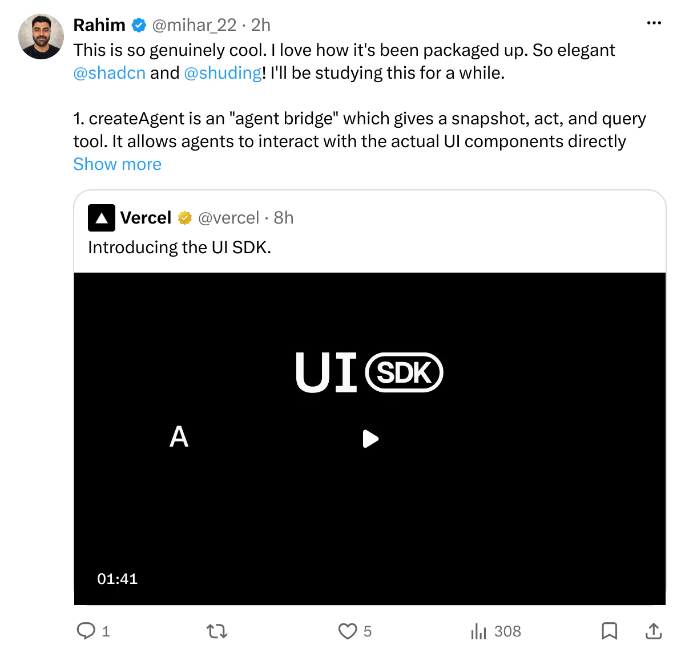</picture>
 <b>Web vs iOS cutoff on a long post — Web (<code>web-timeline · 600</code>).</b> Web cuts at 278 chars with block Show more; iOS (duo · 382) clamps the full note at 9 rows inline.
</td>
<td width="50%" valign="top">
<picture><source media="(prefers-color-scheme: dark)" srcset="gallery/duo-mihar-ios-dark.webp"><source media="(prefers-color-scheme: light)" srcset="gallery/duo-mihar-ios-light.webp">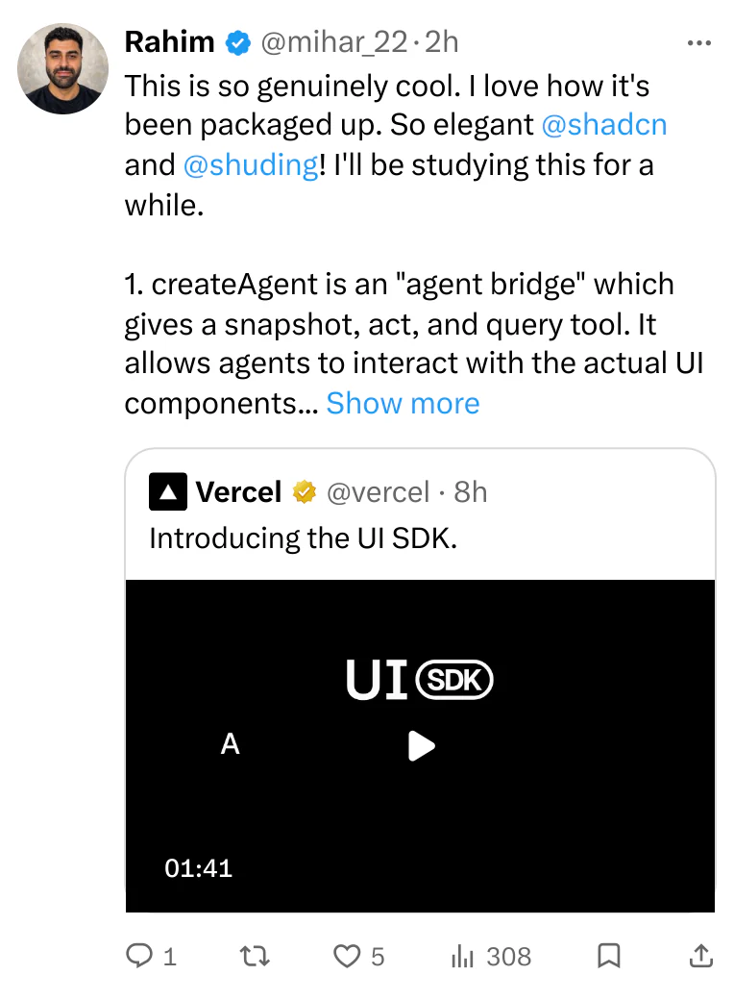</picture>
 <b>iOS (<code>ios-timeline · 382</code>).</b> <a href="https://x.com/mihar_22/status/2121039800329457748">Source post</a>
</td>
</tr>
<tr>
<td width="50%" valign="top">
<picture><source media="(prefers-color-scheme: dark)" srcset="gallery/duo-bscholl-web-dark.webp"><source media="(prefers-color-scheme: light)" srcset="gallery/duo-bscholl-web-light.webp">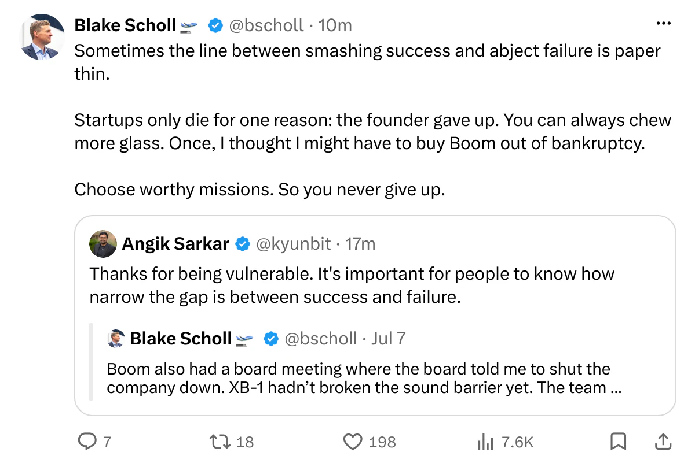</picture>
 <b>Nine lines on iOS, full post on web, quote of a quote — Web (<code>web-timeline · 600</code>).</b> 272 chars: never truncated on web, yet tall enough across three paragraphs to clamp on iOS.
</td>
<td width="50%" valign="top">
<picture><source media="(prefers-color-scheme: dark)" srcset="gallery/duo-bscholl-ios-dark.webp"><source media="(prefers-color-scheme: light)" srcset="gallery/duo-bscholl-ios-light.webp">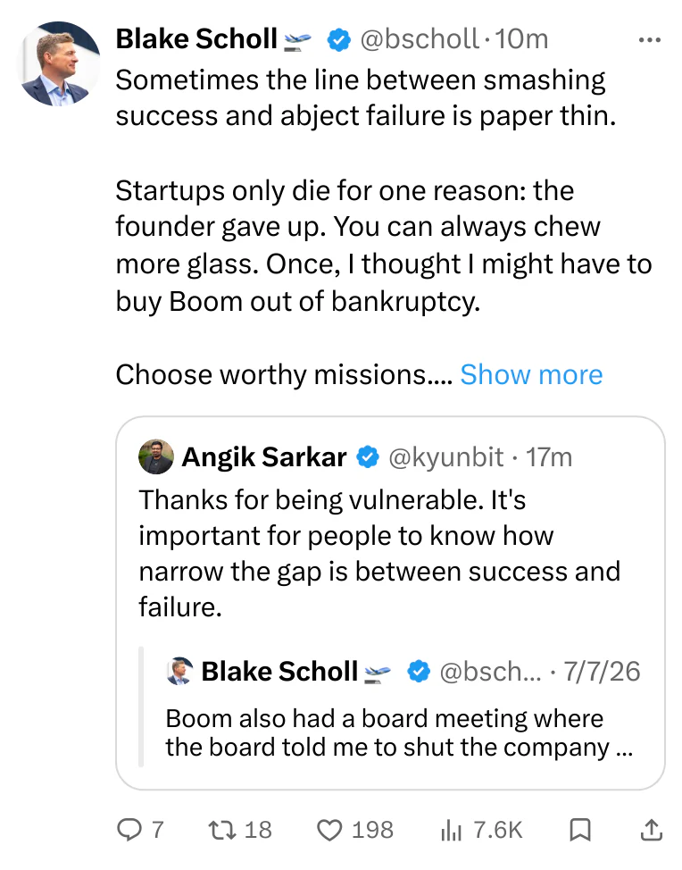</picture>
 <b>iOS (<code>ios-timeline · 382</code>).</b> <a href="https://x.com/bscholl/status/2121045779913597432">Source post</a>
</td>
</tr>
<tr>
<td width="50%" valign="top">
<picture><source media="(prefers-color-scheme: dark)" srcset="gallery/jack-20-dark.webp"><source media="(prefers-color-scheme: light)" srcset="gallery/jack-20-light.webp">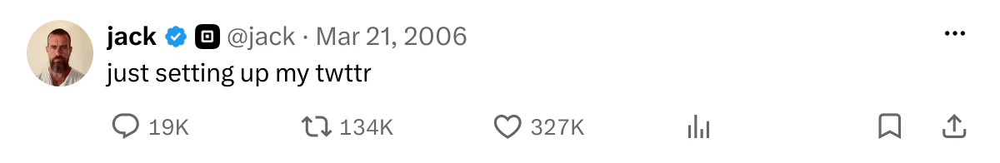</picture>
 <b>Post ID 20 (March 21, 2006).</b> The root post of X: twenty-year timestamp formatting across web and iOS, plus the Square affiliate badge. <a href="https://x.com/jack/status/20">Source</a>
</td>
<td width="50%" valign="top">
<picture><source media="(prefers-color-scheme: dark)" srcset="gallery/nasa-dark.webp"><source media="(prefers-color-scheme: light)" srcset="gallery/nasa-light.webp">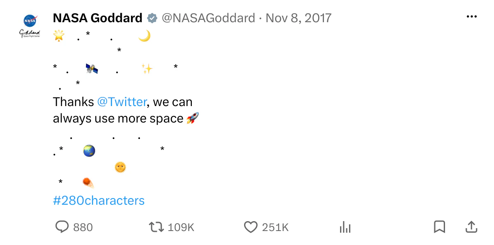</picture>
 <b>Emoji as layout.</b> Runs of spaces, emoji and a hashtag, positioned by hand in 2017. <a href="https://x.com/NASAGoddard/status/928356699043491842">Source</a>
</td>
</tr>
<tr>
<td width="50%" valign="top">
<picture><source media="(prefers-color-scheme: dark)" srcset="gallery/anyways-dark.webp"><source media="(prefers-color-scheme: light)" srcset="gallery/anyways-light.webp">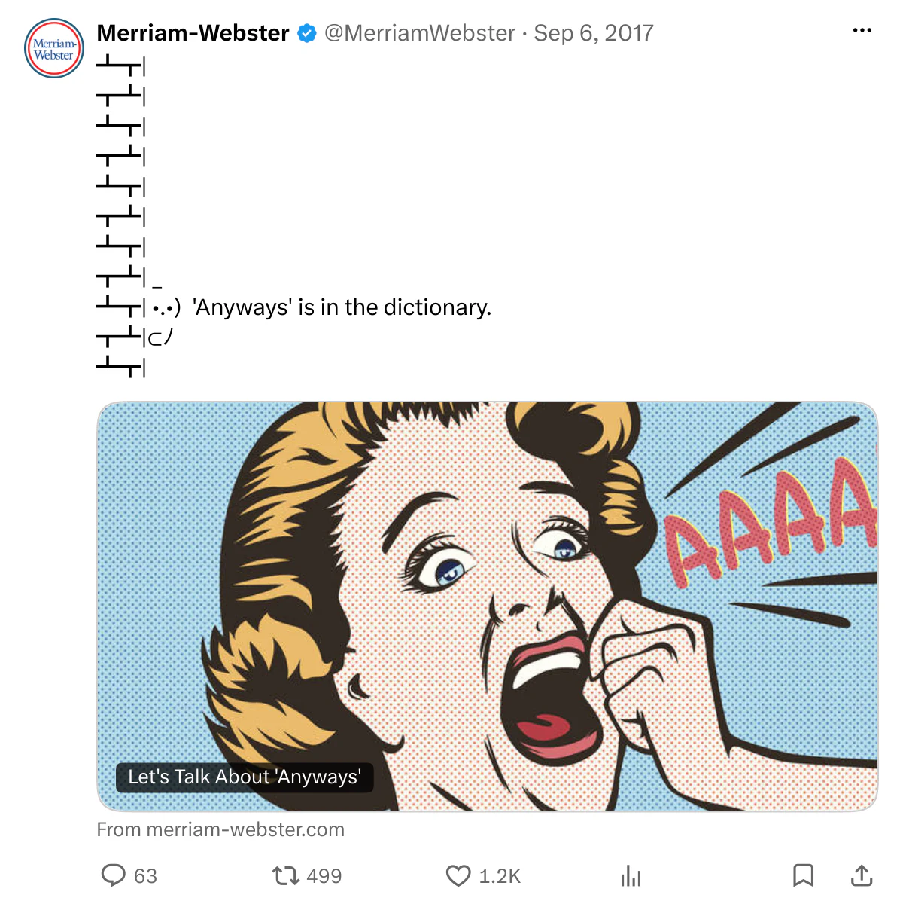</picture>
 <b>Box drawing and halfwidth katakana.</b> ┻┳ and ﾉ are not in X's fonts, so the fallback has to match the platform's. <a href="https://x.com/MerriamWebster/status/905445022878879744">Source</a>
</td>
<td width="50%" valign="top">
<picture><source media="(prefers-color-scheme: dark)" srcset="gallery/whataboutism-dark.webp"><source media="(prefers-color-scheme: light)" srcset="gallery/whataboutism-light.webp">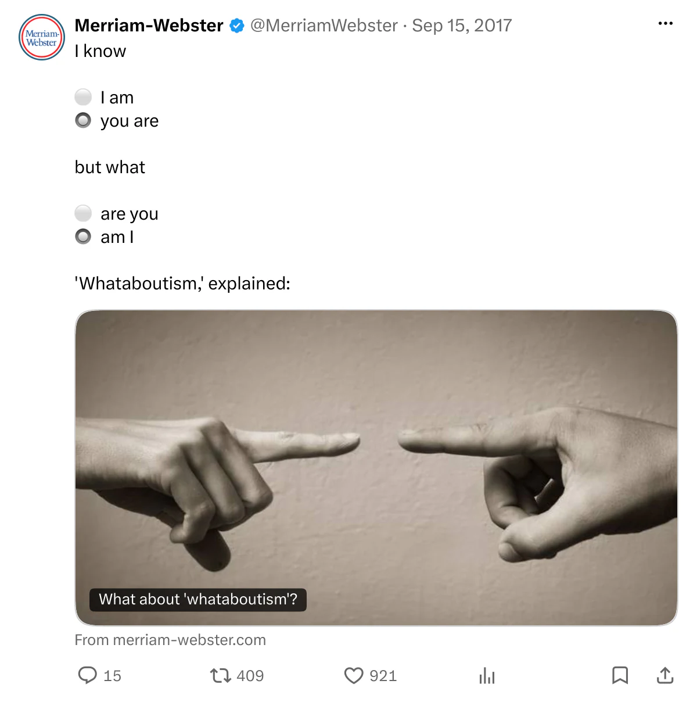</picture>
 <b>Radio buttons made of emoji.</b> ⚪️ and 🔘 need their emoji presentation, and the trailing link becomes a card. <a href="https://x.com/MerriamWebster/status/908706514302570497">Source</a>
</td>
</tr>
<tr>
<td width="50%" valign="top">
<picture><source media="(prefers-color-scheme: dark)" srcset="gallery/pizza-dark.webp"><source media="(prefers-color-scheme: light)" srcset="gallery/pizza-light.webp">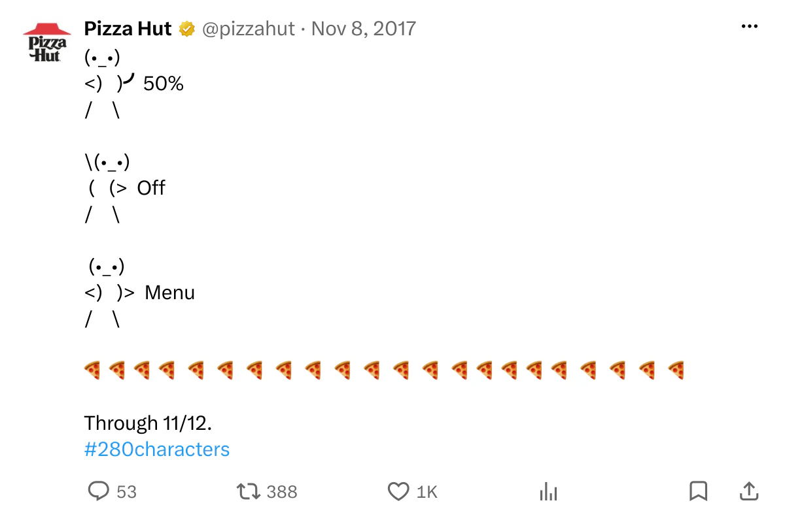</picture>
 <b>A dancing figure.</b> Kaomoji, ╯, preserved spaces and a line of pizza emoji that has to wrap. <a href="https://x.com/pizzahut/status/928347864471875585">Source</a>
</td>
<td width="50%" valign="top">
<picture><source media="(prefers-color-scheme: dark)" srcset="gallery/rauchg-math-nested-dark.webp"><source media="(prefers-color-scheme: light)" srcset="gallery/rauchg-math-nested-light.webp">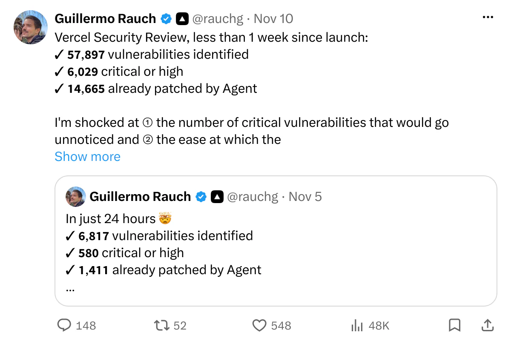</picture>
 <b>Math digits, checkmarks, Show more & nested quote.</b> ✓, sans-serif bold math digits (𝟱𝟳,𝟴𝟵𝟳), circled ① ②, Show more truncation, and a two-level quote of a quote. <a href="https://x.com/rauchg/status/2120188488628977819">Source</a>
</td>
</tr>
<tr>
<td width="50%" valign="top">
<picture><source media="(prefers-color-scheme: dark)" srcset="gallery/espn-attribution-dark.webp"><source media="(prefers-color-scheme: light)" srcset="gallery/espn-attribution-light.webp">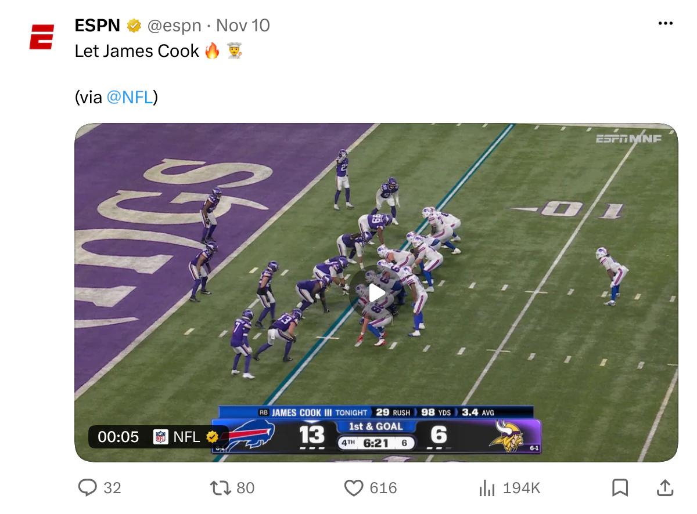</picture>
 <b>ZWJ emoji & From NFL video attribution.</b> 👨‍🍳 is a three-code-point ZWJ sequence, and the embedded video credits From NFL next to the duration. <a href="https://x.com/espn/status/2120005259485425936">Source</a>
</td>
<td width="50%" valign="top">
<picture><source media="(prefers-color-scheme: dark)" srcset="gallery/showmore-dark.webp"><source media="(prefers-color-scheme: light)" srcset="gallery/showmore-light.webp">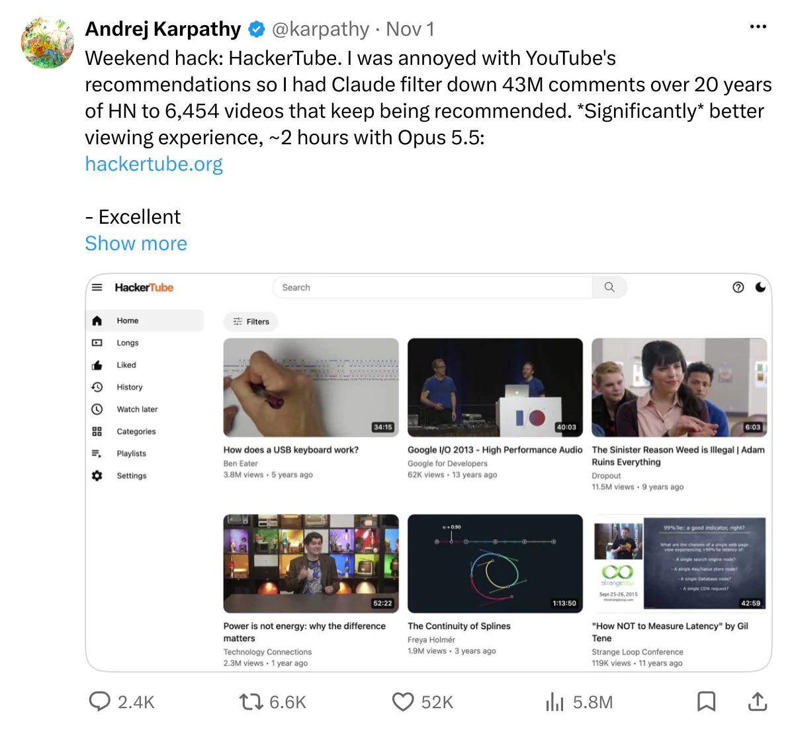</picture>
 <b>Long post Show more & note entity links.</b> Timeline renders X's server cut with block Show more; expanded and detail show the full HackerTube note. <a href="https://x.com/karpathy/status/2116957135661945283">Source</a>
</td>
</tr>
<tr>
<td width="50%" valign="top">
<picture><source media="(prefers-color-scheme: dark)" srcset="gallery/poll-dark.webp"><source media="(prefers-color-scheme: light)" srcset="gallery/poll-light.webp">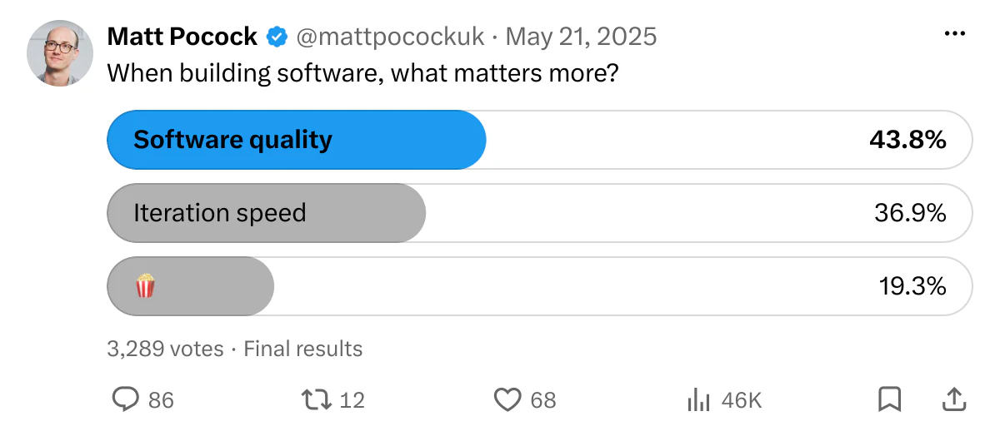</picture>
 <b>A finished developer poll.</b> Three bars (including 🍿) sized from 3,289 votes: pill bars on web and rectangular bars on iOS. <a href="https://x.com/mattpocockuk/status/1925021766793019888">Source</a>
</td>
<td width="50%" valign="top">
<picture><source media="(prefers-color-scheme: dark)" srcset="gallery/video-and-quote-dark.webp"><source media="(prefers-color-scheme: light)" srcset="gallery/video-and-quote-light.webp">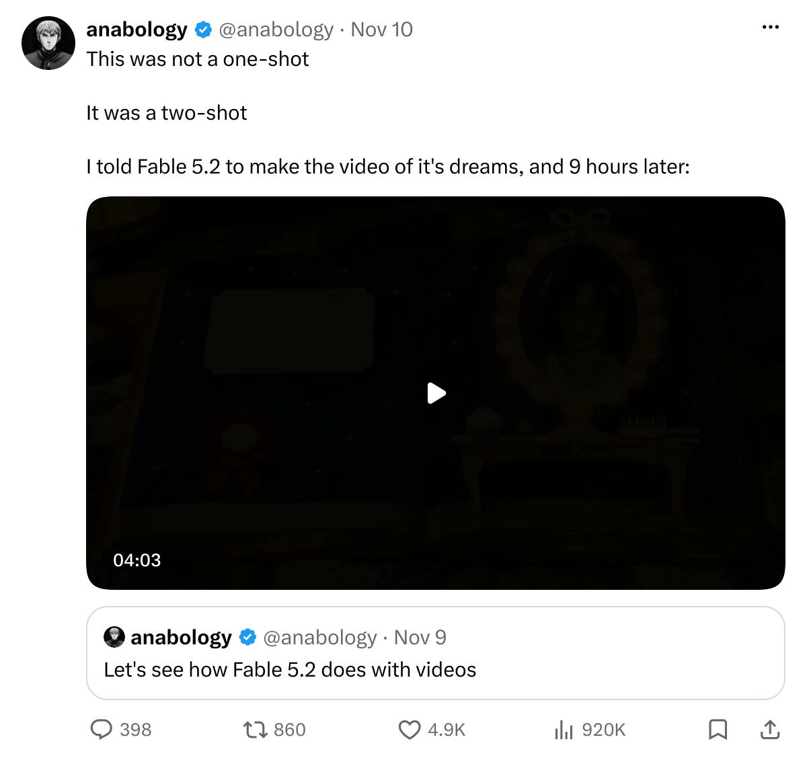</picture>
 <b>Video and a quote together.</b> Media and a quoted post share one attachment slot: the 16:9 video renders above a compact quote card with a 16 px avatar. <a href="https://x.com/anabology/status/2120010995309457643">Source</a>
</td>
</tr>
<tr>
<td width="50%" valign="top">
<picture><source media="(prefers-color-scheme: dark)" srcset="gallery/vertical-video-dark.webp"><source media="(prefers-color-scheme: light)" srcset="gallery/vertical-video-light.webp">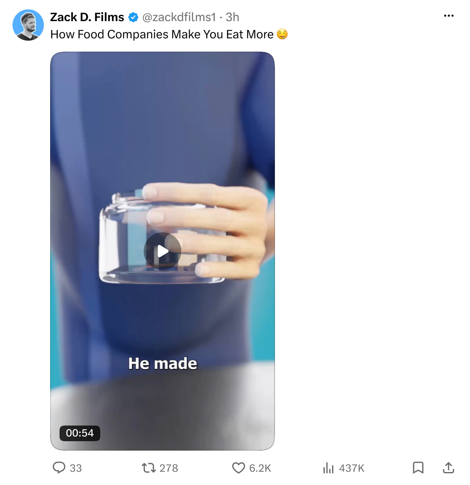</picture>
 <b>A 9:16 vertical video.</b> Portrait media keeps its 9:16 aspect ratio at narrow widths and caps height at 510 px on wide columns, left-aligned on timeline. <a href="https://x.com/zackdfilms1/status/2121016684291014940">Source</a>
</td>
<td width="50%" valign="top">
<picture><source media="(prefers-color-scheme: dark)" srcset="gallery/two-image-carousel-dark.webp"><source media="(prefers-color-scheme: light)" srcset="gallery/two-image-carousel-light.webp">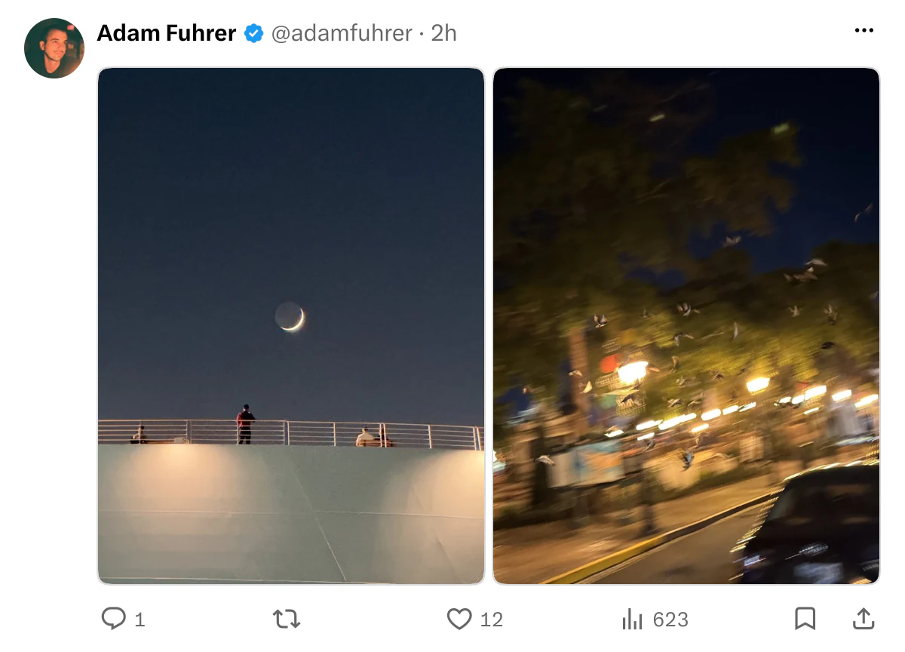</picture>
 <b>Two-image portrait carousel.</b> Two 3:4 photos fit side by side with squircle borders, so no indicator pills render even with empty text. <a href="https://x.com/adamfuhrer/status/2121031916971593832">Source</a>
</td>
</tr>
<tr>
<td width="50%" valign="top">
<picture><source media="(prefers-color-scheme: dark)" srcset="gallery/twenty-image-carousel-dark.webp"><source media="(prefers-color-scheme: light)" srcset="gallery/twenty-image-carousel-light.webp">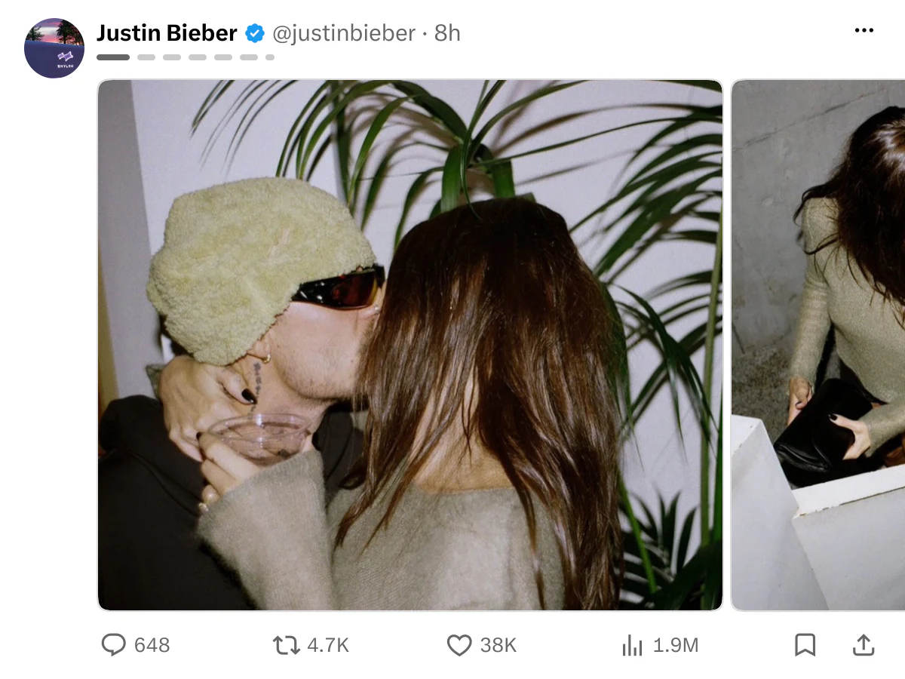</picture>
 <b>20-image carousel with overflow & indicators.</b> Textless overflowing carousels add pill indicators above the slides and bleed the peeking slide right. <a href="https://x.com/justinbieber/status/2120954896363200630">Source</a>
</td>
<td width="50%" valign="top">
<picture><source media="(prefers-color-scheme: dark)" srcset="gallery/twenty-strip-panorama-dark.webp"><source media="(prefers-color-scheme: light)" srcset="gallery/twenty-strip-panorama-light.webp">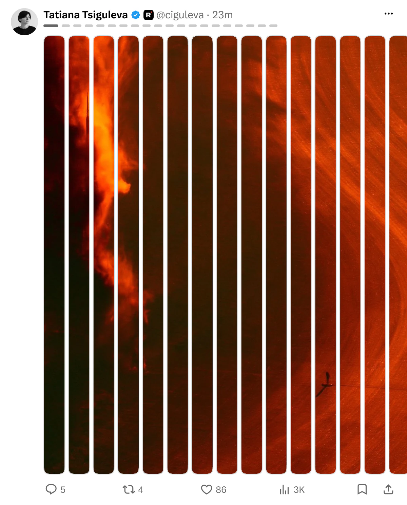</picture>
 <b>20-strip panoramic carousel.</b> Twenty 102×2048 vertical slices spaced 4 px apart, with a 7-slot windowed indicator bar and the affiliate badge. <a href="https://x.com/ciguleva/status/2121073443533881486">Source</a>
</td>
</tr>
<tr>
<td width="50%" valign="top">
<picture><source media="(prefers-color-scheme: dark)" srcset="gallery/mri-video-poster-dark.webp"><source media="(prefers-color-scheme: light)" srcset="gallery/mri-video-poster-light.webp">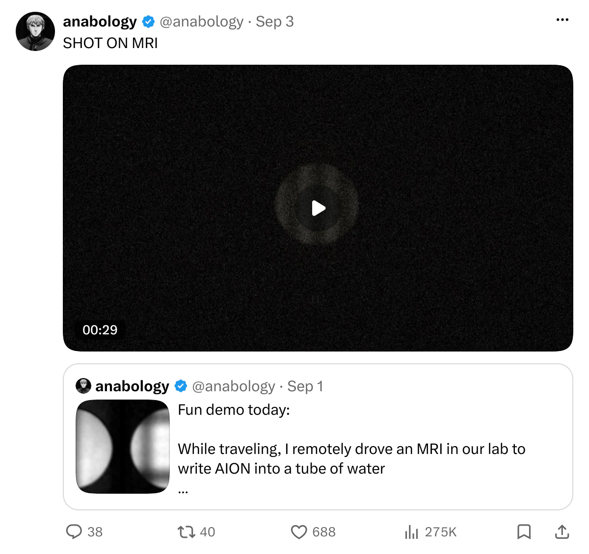</picture>
 <b>Video poster + compact vs detail quote media.</b> Timeline shrinks quoted media under a video to a 96×96 square; detail keeps the full 4.18:1 MRI strip. <a href="https://x.com/anabology/status/2095355496530071898">Source</a>
</td>
<td width="50%" valign="top"></td>
</tr>
</table>
